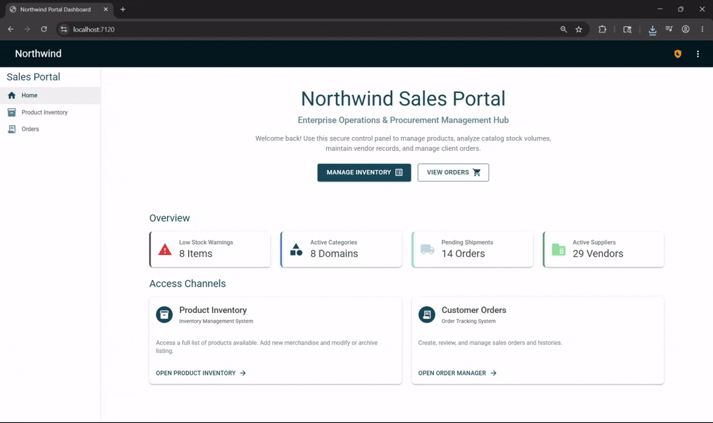
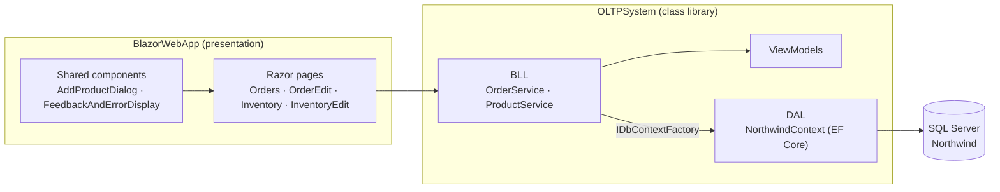

# Northwind Sales Portal

[](https://github.com/naeunchin/northwind-app/actions/workflows/ci.yml)


An order and inventory management portal for the classic **Northwind** sample database, built with **.NET 8 Blazor (Interactive Server)**, **Entity Framework Core** and **MudBlazor**.

Employees can search, create, edit and delete sales orders with a shopping-cart style line-item editor, and maintain the product catalog with validated forms. Behind the UI, a separate business-logic layer enforces the rules and returns structured results instead of throwing, and the whole stack is covered by unit, component and containerized integration tests that run in CI on every push.

---

## Table of Contents

- [Demo](#demo)
- [Features](#features)
- [Architecture](#architecture)
- [Tech Stack](#tech-stack)
- [Getting Started](#getting-started)
- [Testing](#testing)
- [Continuous Integration](#continuous-integration)
- [Project Structure](#project-structure)
- [Roadmap](#roadmap)
- [Known Limitations](#known-limitations)

---

## Demo

<details>
<summary><strong>Orders page</strong>: search, edit and manage order line items (click to expand)</summary>


</details>

<details>
<summary><strong>Inventory page</strong>: search the catalog and edit products (click to expand)</summary>



</details>

---

## Features

### Order management
- **Browse and search:** all orders load newest-first in a sortable data grid. Search by exact **order ID** (numeric input) or by partial, case-insensitive **customer ID**.
- **Create and edit orders:** select the customer, sales representative, order date, freight, destination, shipping carrier and shipped date.
- **Shopping-cart line items:** add products through a dialog with quantity and discount, update the quantity when a product is added twice, and remove individual lines. Line totals are calculated live, including discounts.
- **Line-item synchronization:** saving an existing order adds new lines, updates changed ones and deletes removed ones in a single transaction, so a failed save never leaves a partial order behind.
- **Safe deletion:** deleting an order asks for confirmation, then removes the order together with its detail lines.

### Inventory management
- **Browse and search:** search products by **product ID** or partial, case-insensitive **name**. Category, supplier, price, stock and an *Active* / *Discontinued* status chip are shown for each product.
- **Create and edit products:** a validated form with category and supplier dropdowns, pricing, stock levels, reorder threshold and a discontinued toggle.

### Validation and user feedback
- **Business rules are enforced in the service layer**, independent of the UI:
  - **Products:** name required (max 40 characters, matching the database column), category and supplier required, no negative prices or stock values, and no duplicate names (case-insensitive).
  - **Orders:** customer and sales representative required, at least one line item.
- **Results instead of exceptions:** services return `Result<T>` objects (via [BYSResults](https://www.nuget.org/packages/BYSResults)) that carry either data or a list of errors. Pages turn these into inline alerts and snackbars rather than crashing.
- **Unsaved-changes protection:** leaving an edited form asks for confirmation before discarding changes.

---

## Architecture

The solution separates presentation from business logic and data access (image generated by Claude):



| Layer | Responsibility |
|---|---|
| **BlazorWebApp** | Razor components with code-behind (`.razor.cs`) files, MudBlazor UI and navigation. It talks to the services and works with view models only, never with EF entities. |
| **OLTPSystem / BLL** | `OrderService` and `ProductService` hold the validation rules, query projections and save logic, and return `Result<T>`. |
| **OLTPSystem / ViewModels** | Flat DTOs shaped for the UI (`OrderView`, `ProductView`, lookup views). |
| **OLTPSystem / DAL** | `NorthwindContext` and entities, scaffolded from the Northwind database with EF Core Power Tools. |

### Design decisions

- **One `DbContext` per operation.** In Blazor Server, a dependency-injection scope lasts as long as the user's connection (often as long as the browser tab is open). A single scoped `DbContext` would accumulate tracked entities, serve stale data and fail when two operations overlap. The services therefore take an `IDbContextFactory<NorthwindContext>` and create a short-lived context per method, as Microsoft recommends for Blazor Server.
- **View models at the boundary.** Services project queries straight into view models, so EF entities and navigation properties never reach the UI.
- **One registration entry point.** `OLTPDependencies()` (`OLTPSystem/OLTPExtension.cs`) registers the context factory and services, so the web app needs a single line in `Program.cs`.

---

## Tech Stack

| Area | Technology |
|---|---|
| Framework | .NET 8, Blazor Web App (Interactive Server render mode) |
| UI | MudBlazor 8 |
| Data access | Entity Framework Core 8 (SQL Server provider) |
| Database | Microsoft SQL Server, Northwind sample database |
| Result handling | BYSResults |
| Unit and component tests | xUnit, bUnit, FluentAssertions, EF Core SQLite (in-memory) |
| Integration tests | Testcontainers (SQL Server 2022), Respawn |
| CI | GitHub Actions |

---

## Getting Started

### Prerequisites

- [.NET 8 SDK](https://dotnet.microsoft.com/download/dotnet/8.0) or newer
- Microsoft SQL Server (LocalDB, Express, Developer or a container)
- SQL Server Management Studio or Azure Data Studio, to import the database
- [Docker](https://www.docker.com/) (only needed for the integration tests)

### 1. Clone the repository

```bash
git clone https://github.com/naeunchin/northwind-app.git
cd northwind-app
```

### 2. Import the database

The repository includes a Northwind database export at `Database/Northwind.bacpac`. Import it into your SQL Server instance:

- **SSMS:** right-click **Databases** → **Import Data-tier Application…** → select the `.bacpac` file.
- **Azure Data Studio:** use the **SQL Server Dacpac** extension → **Import Bacpac**.

### 3. Configure the connection string

The app reads a connection string named **`NorthwindConnection`**. The recommended way to set it is with [user secrets](https://learn.microsoft.com/aspnet/core/security/app-secrets), which keeps credentials out of source control:

```bash
dotnet user-secrets set "ConnectionStrings:NorthwindConnection" "Server=localhost;Database=Northwind;Trusted_Connection=True;TrustServerCertificate=True" --project BlazorWebApp
```

Adjust the server name and authentication for your environment. Alternatively, set it in `BlazorWebApp/appsettings.Development.json` (avoid committing real credentials):

```json
{
  "ConnectionStrings": {
    "NorthwindConnection": "Server=localhost;Database=Northwind;Trusted_Connection=True;TrustServerCertificate=True"
  }
}
```

### 4. Run the app

```bash
dotnet run --project BlazorWebApp
```

Then open the URL shown in the console (by default `http://localhost:5068`). In Visual Studio 2022, open `NorthwindApp.sln` and press **F5**.

---

## Testing

The solution has two test projects:

| Project | What it covers | Database |
|---|---|---|
| **UnitTests** | Service business rules and queries; component tests for every page and dialog (rendering, search, form saves, cart edits, confirmation dialogs, navigation); dependency-injection registration | In-memory SQLite |
| **IntegrationTests** | Service behavior against a real SQL Server: identity keys, foreign keys, column length limits, transactional rollback and SQL translation of case-insensitive search | SQL Server 2022 in Docker |

### Run the tests

```bash
# Unit and component tests (no external dependencies)
dotnet test UnitTests

# Integration tests (Docker must be running)
dotnet test IntegrationTests

# Everything
dotnet test
```

### How the integration tests work

- **One container per run:** [Testcontainers](https://dotnet.testcontainers.org/) starts a single SQL Server 2022 container for the whole test run and removes it afterwards.
- **Schema from the EF model:** the schema is built from the EF Core model with `EnsureCreated`, so the integration tests don't need the `.bacpac` import.
- **Clean data for every test:** [Respawn](https://github.com/jbogard/Respawn) deletes all rows and resets identity seeds before each test.
- **Run serially:** the tests run one at a time, sharing the database through an xUnit collection fixture.

The first run downloads the SQL Server image (about 1.5 GB). To download it ahead of time:

```bash
docker pull mcr.microsoft.com/mssql/server:2022-latest
```

---

## Continuous Integration

Every push and pull request to `main` runs the [CI workflow](.github/workflows/ci.yml) on GitHub Actions:

1. Restore NuGet packages (with caching).
2. Build the solution in Release configuration.
3. Run the unit and component tests.
4. Run the integration tests against SQL Server through Testcontainers (Docker is preinstalled on GitHub's Ubuntu runners).
5. Upload `.trx` test results as a build artifact, even when tests fail.

---

## Project Structure

```
NorthwindApp/
├── BlazorWebApp/                 # Blazor Server front end
│   ├── Components/
│   │   ├── Custom/               # FeedbackAndErrorDisplay (shared alert component)
│   │   ├── Layout/               # MainLayout, NavMenu
│   │   └── Pages/
│   │       ├── Home.razor
│   │       └── AppPages/         # Orders, OrderEdit, Inventory, InventoryEdit, AddProductDialog
│   └── Program.cs
├── OLTPSystem/                   # Business logic and data access library
│   ├── BLL/                      # OrderService, ProductService
│   ├── DAL/                      # NorthwindContext
│   ├── Entities/                 # EF Core entities (scaffolded)
│   ├── ViewModels/               # UI-facing DTOs
│   └── OLTPExtension.cs          # Dependency-injection registration
├── UnitTests/
│   ├── Components/               # bUnit page and component tests
│   └── Services/                 # Service and DI tests
├── IntegrationTests/
│   ├── Infrastructure/           # SQL Server container fixture, test base class
│   └── Services/                 # Service tests against SQL Server
├── Database/Northwind.bacpac      # Database export for local setup
├── DemoGif/                      # Demo recordings
└── .github/workflows/ci.yml      # CI pipeline
```

---

## Roadmap

- [ ] Soft delete (for example, a `RemoveFromViewFlag`) instead of permanently deleting orders
- [ ] Server-side pagination and advanced filtering on the Orders grid
- [ ] Reporting dashboard with live logistics and sales metrics
- [ ] Structured logging with `ILogger`, with generic user-facing error messages
- [ ] Upgrade to .NET 10 (LTS), EF Core 10 and MudBlazor 9

---

## Known Limitations

- **Static dashboard figures:** the summary numbers on the Home page are placeholders, not live database figures.
- **No authentication:** every page is open to anyone who can reach the app.
- **Hard deletes:** deleting an order permanently removes it and its line items (see [Roadmap](#roadmap)).
- **Database errors reach the UI:** when a save fails, the database's error message is displayed to the user.

---

© 2026 Na Eun Chin. All Rights Reserved.

This project is for demonstration purposes only as a personal project. Unauthorized copying, modification, or distribution of this codebase is strictly prohibited.
